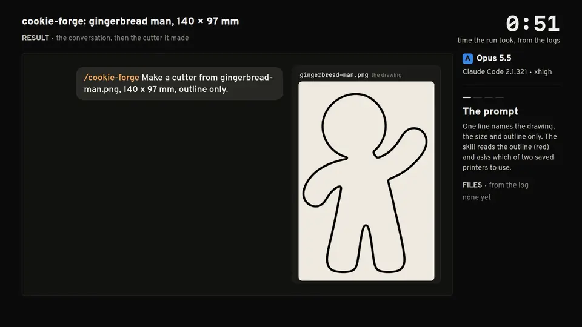
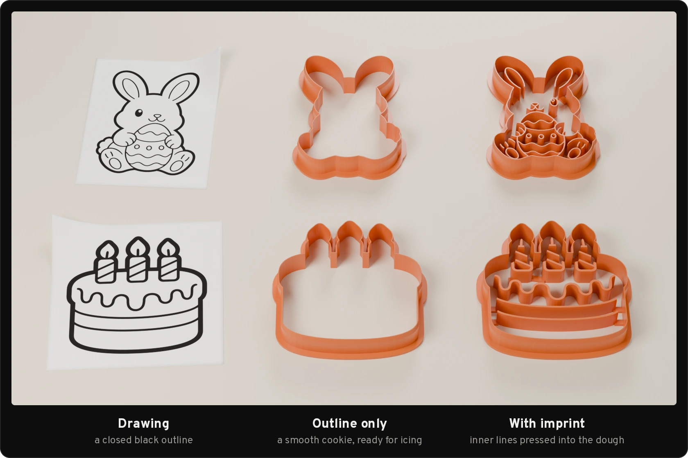
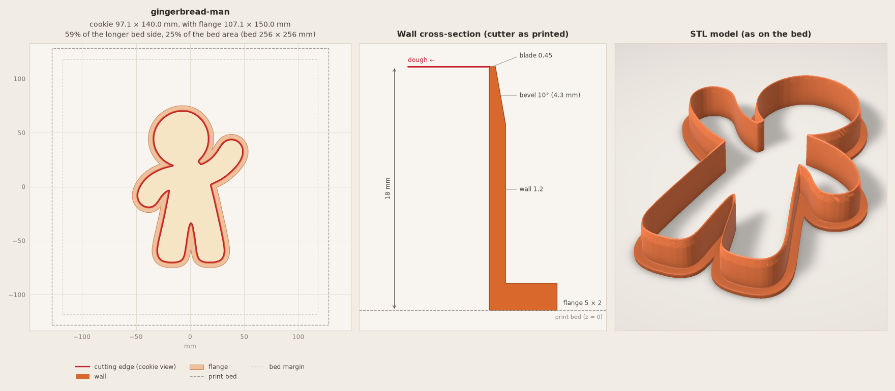
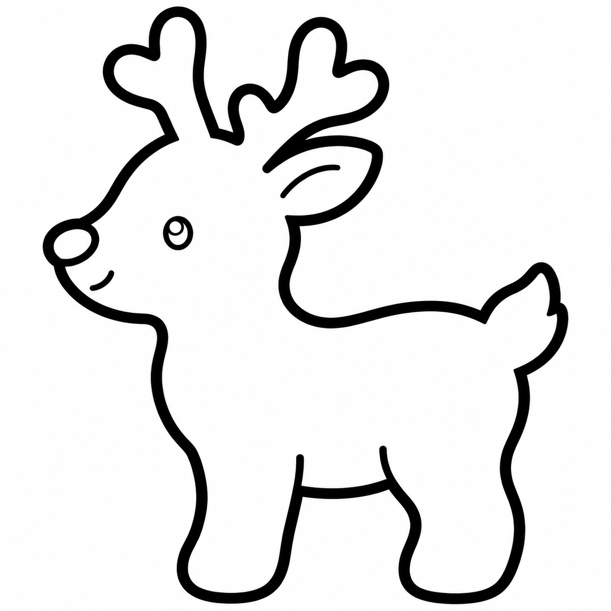
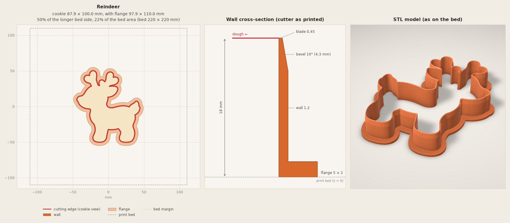
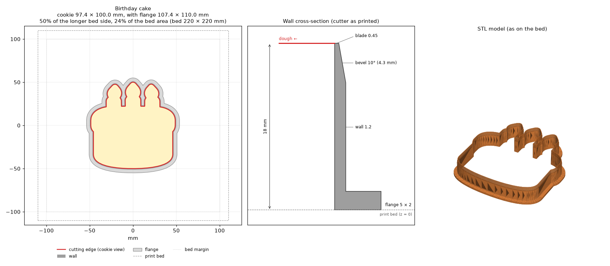
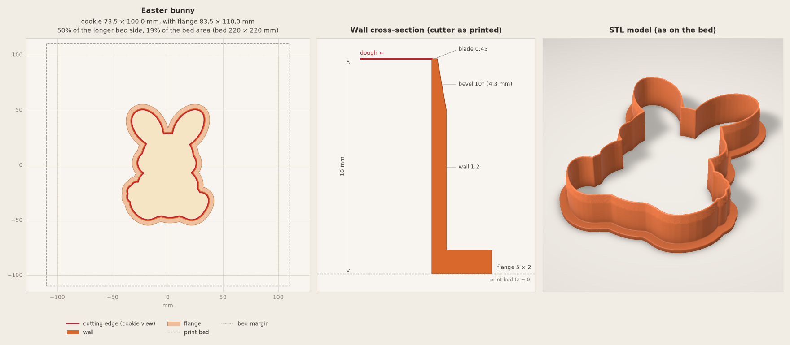
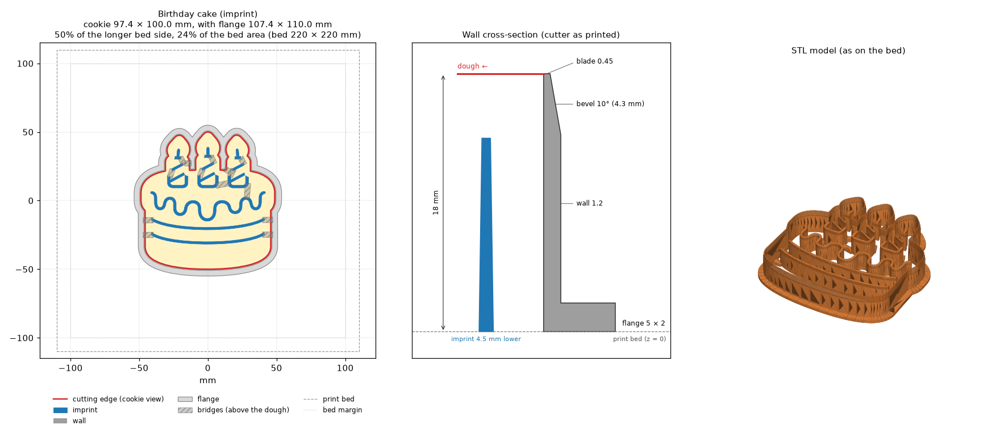
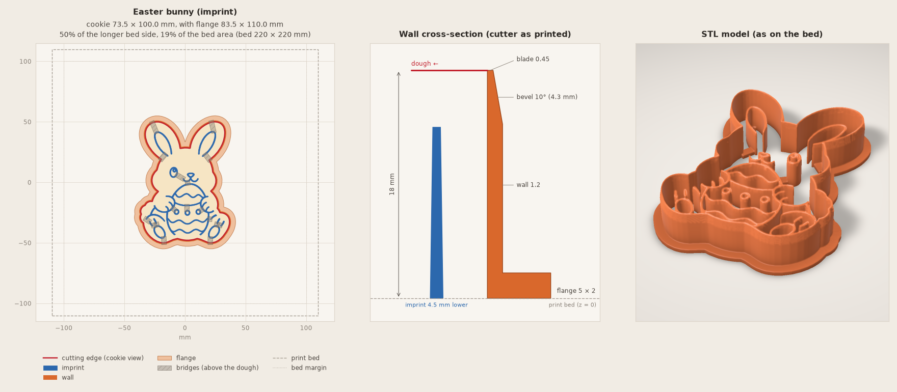

# Cookie Forge

**Turn a drawing into a 3D-printable cookie cutter. Just ask your coding agent.**



Attach a picture, approve the preview, print the STL. No CAD.
Works in Claude Code, Codex and other agents that run `SKILL.md` skills.

## Make your first cutter

**1. Install the plugin** from your terminal:

```bash
claude plugin marketplace add DEVividious/cookie-forge
claude plugin install cookie-forge@cookie-forge
```

**2. Ask for a cutter** in Claude Code, in the folder with your drawing:

```text
/cookie-forge Make a cutter from gingerbread-man.png, 140 x 97 mm, outline only.
```

**3. Approve the preview.** The agent shows how it read the drawing, asks which printer you
have and fits the cutter on its bed. Nothing is built until you say yes. Then
`gingerbread-man-140mm-v1.stl` lands in `cookie-forge-output/exports/<date>/`: print it flange
down, without supports.

That is the session in the clip above. To repeat it, save
[this gingerbread man](examples/gingerbread-man/140mm/source.png) as `gingerbread-man.png`.

You need Git, Python 3.10+ and [uv](https://docs.astral.sh/uv/getting-started/installation/).
The first cutter takes longer: uv downloads the geometry libraries once.

<details>
<summary>Codex, Windows, other agents, manual install</summary>

<br>

**Codex**

```bash
codex plugin marketplace add DEVividious/cookie-forge
codex plugin add cookie-forge@cookie-forge
```

Leave `/cookie-forge` out of the prompt: Codex picks the skill from its description.

**Inside a Claude Code session** (2.1.275 or later), one command does both install steps:
`/plugin install cookie-forge --marketplace DEVividious/cookie-forge`

**Windows PowerShell:** the same commands. Install uv with `winget install --id=astral-sh.uv -e`
and reopen the terminal. Native Windows is not yet verified end to end, see
[Compatibility](docs/guide.md#compatibility).

**Other agents:** `npx skills add DEVividious/cookie-forge` uses the [skills.sh](https://skills.sh)
installer. Add `-g` to install for all projects.

**Manual:** copy `plugins/cookie-forge/skills/cookie-forge/` from a clone into your agent's
skill directory. `SKILL.md`, `scripts/` and `references/` must stay together. In Claude Code,
`claude --plugin-dir path/to/cookie-forge/plugins/cookie-forge` loads the plugin for one session;
copy or link that folder to `~/.claude/skills/cookie-forge` to load it in every session.

More: [Claude Code plugins](https://code.claude.com/docs/en/plugins/install.md) ·
[Codex skills](https://learn.chatgpt.com/docs/build-skills)

</details>

## One drawing, two cutters



**Outline only** leaves the cookie smooth for icing. **With imprint**, the drawing's inner
lines become lower ridges that press the pattern into the dough instead of cutting through it.

These are real STLs. Click one and GitHub shows it in 3D, or download and print it:

| | Drawing | Outline only | With imprint |
|---|---|---|---|
| Easter bunny | [PNG](examples/easter-bunny/100mm/source.png) | [STL](examples/easter-bunny/100mm/cutter.stl) | [STL](examples/easter-bunny-imprint/100mm/cutter.stl) |
| Birthday cake | [PNG](examples/birthday-cake/100mm/source.png) | [STL](examples/birthday-cake/100mm/cutter.stl) | [STL](examples/birthday-cake-imprint/100mm/cutter.stl) |
| Reindeer | [PNG](examples/reindeer/100mm/source.png) | [STL](examples/reindeer/100mm/cutter.stl) | |
| Gingerbread man | [PNG](examples/gingerbread-man/140mm/source.png) | [STL](examples/gingerbread-man/140mm/cutter.stl) | |

<details>
<summary>The preview you approve, for all six cutters</summary>

<br>

Top view, wall cross-section and 3D model. The gingerbread man is 140 mm, for a Bambu Lab P2S;
the others are 100 mm, for a Creality K1C. Each folder also holds the settings (`project.json`)
and print notes (`notes.md`).

| Drawing | Preview | Files |
|---|---|---|
|  |  | [gingerbread man](examples/gingerbread-man/140mm/) |
|  |  | [reindeer](examples/reindeer/100mm/) |
|  |  | [birthday cake](examples/birthday-cake/100mm/) |
|  |  | [Easter bunny](examples/easter-bunny/100mm/) |
|  |  | [birthday cake with imprint](examples/birthday-cake-imprint/100mm/) |
|  |  | [Easter bunny with imprint](examples/easter-bunny-imprint/100mm/) |

</details>

## Made for dough

- **Cuts clean.** A 0.45 mm cutting edge with a 10° bevel on the outside only, so the side of
  the cookie comes out straight.
- **Prints easy.** A solid 1.2 mm wall on a 5 × 2 mm flange you can press on. No supports, no brim.
- **Reads the right way round.** The model is mirrored, so text and left-facing animals come
  out like the drawing.
- **Checked before you print.** Sized against your printer's bed, with warnings for parts too
  thin to survive and notches where dough will stick. Every STL is a single watertight solid.
- **Easy to change.** *"Make the same cutter 80 mm"* or *"smooth that notch"* builds a new
  version next to the old one.

## Good to know

- **Size** is the longest side of the cookie, not counting the grip flange.
- **Drawings** can be PNG, JPG, WEBP or PDF. A closed black outline on white works best. Only
  have an idea? Use the [prompts for image models](plugins/cookie-forge/skills/cookie-forge/references/templates.md#prompts-for-image-models).
- **Printers:** 60+ bed sizes are built in, and any other works by its dimensions. Say *"Add my
  default printers: Creality K1C and Bambu Lab P2S"* once and the skill
  [remembers them](docs/guide.md#your-printers).
- **Language:** ask in whichever you like.

## Docs

- [Guide](docs/guide.md): the full walkthrough, your printers, printing, where files go,
  troubleshooting, compatibility
- [Command line](docs/cli.md): run the geometry engine without an agent
- [Template tips](plugins/cookie-forge/skills/cookie-forge/references/templates.md) ·
  [Cutter geometry](plugins/cookie-forge/skills/cookie-forge/references/geometry.md) ·
  [Printer table](plugins/cookie-forge/skills/cookie-forge/references/printers.md)
- [Changelog](CHANGELOG.md) · [Development](docs/development.md)

## License

[MIT](LICENSE)
