# Cookie Forge

**Turn a drawing into a 3D-printable cookie cutter. Just ask your coding agent.**

A skill for Claude Code, Codex and other agents that run `SKILL.md` skills.
Attach a picture, approve the preview, print the STL. No CAD needed.

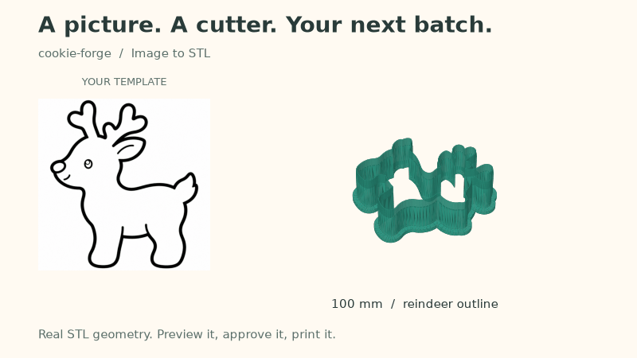

**[Make your first cutter →](#quick-start)**

[Real examples](#real-results) · [CLI demo](#try-it-without-an-agent) · [Sample STL](examples/reindeer/100mm/cutter.stl) · [Still image](examples/showcase.png)

## Real results

Each render below shows an actual STL from [`examples/`](examples/), as it sits on the print bed.
One template can produce two cutters:

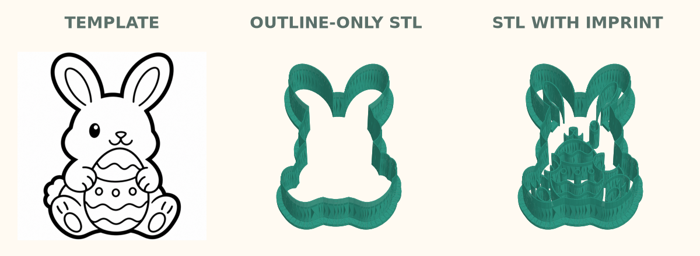

**Easter bunny, 100 mm:** [template](examples/easter-bunny/100mm/source.png) · [outline STL](examples/easter-bunny/100mm/cutter.stl) · [imprint STL](examples/easter-bunny-imprint/100mm/cutter.stl)

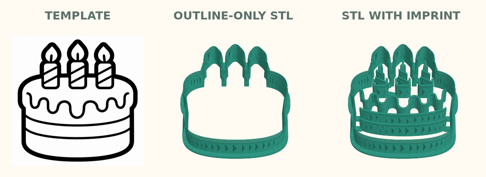

**Birthday cake, 100 mm:** [template](examples/birthday-cake/100mm/source.png) · [outline STL](examples/birthday-cake/100mm/cutter.stl) · [imprint STL](examples/birthday-cake-imprint/100mm/cutter.stl)

**Outline only** leaves the cookie smooth for icing. **With imprint**, the drawing's inner lines
become lower ridges that press the pattern into the dough instead of cutting through it.

<details>
<summary>All five examples with technical previews, settings and print notes</summary>

<br>

All five cutters were made by running the whole skill (100 mm, Creality K1C). Each directory
holds one finished cutter: `cutter.stl`, `preview.png`, `source.png` (the template used),
`project.json` and `notes.md`. When you use the skill, files go to a workspace with separate
exports, builds, previews and templates; see [where your files go](#reference).

| Template | Preview: top view, wall cross-section, 3D model | Files |
|---|---|---|
| 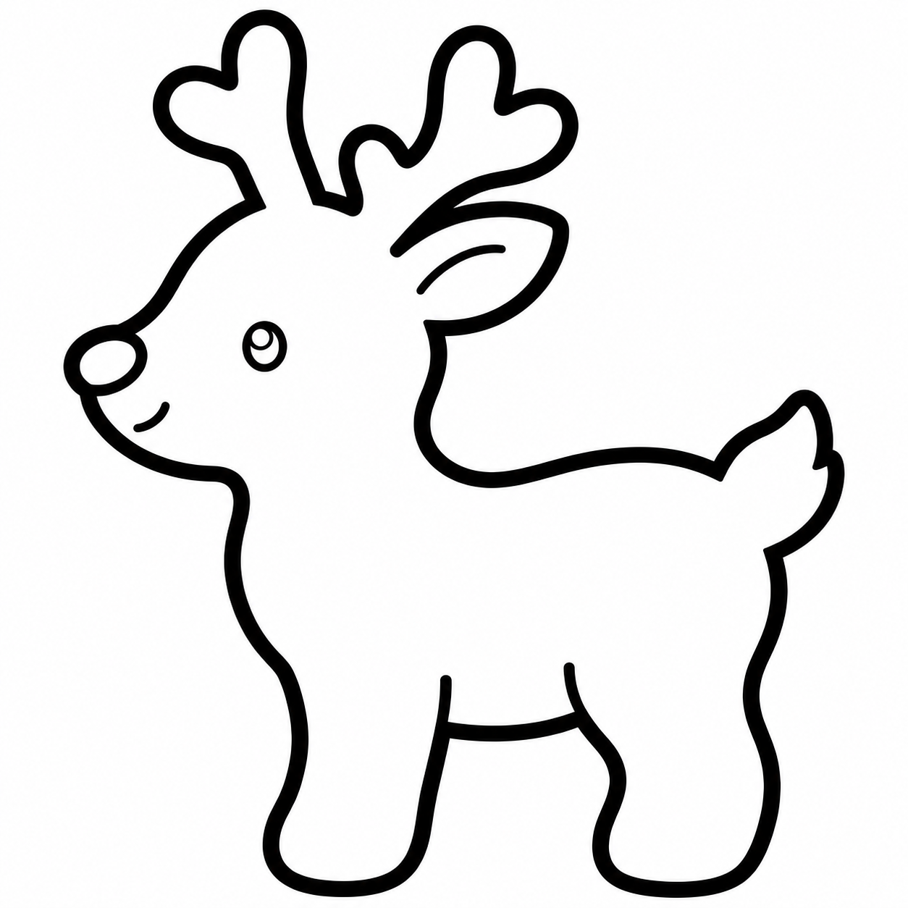 | 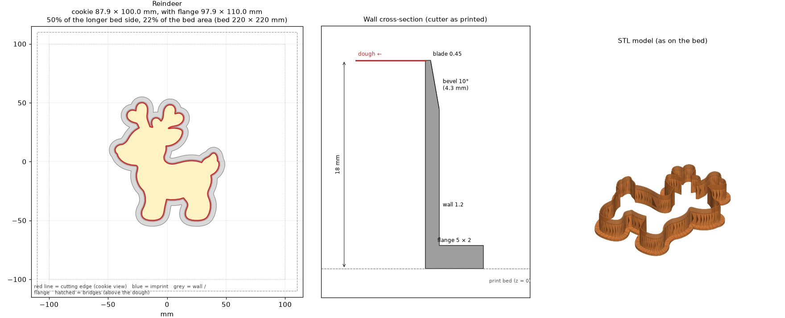 | [reindeer](examples/reindeer/100mm/) |
|  | 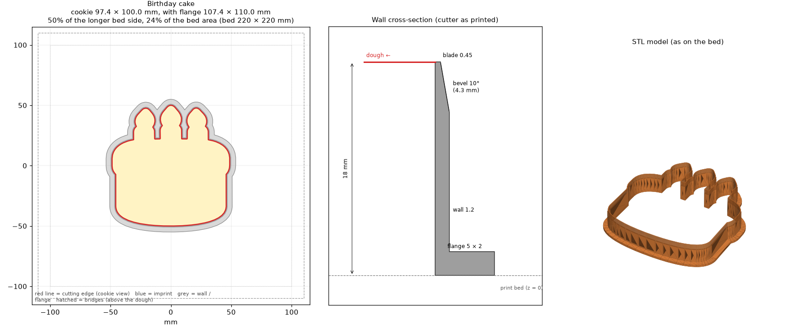 | [birthday cake](examples/birthday-cake/100mm/) |
| 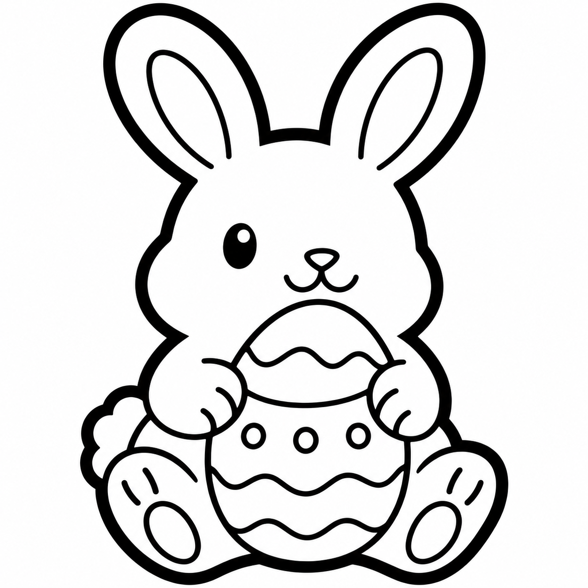 | 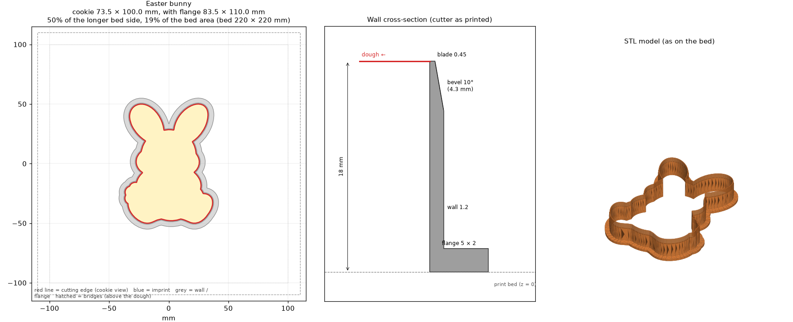 | [Easter bunny](examples/easter-bunny/100mm/) |
|  | 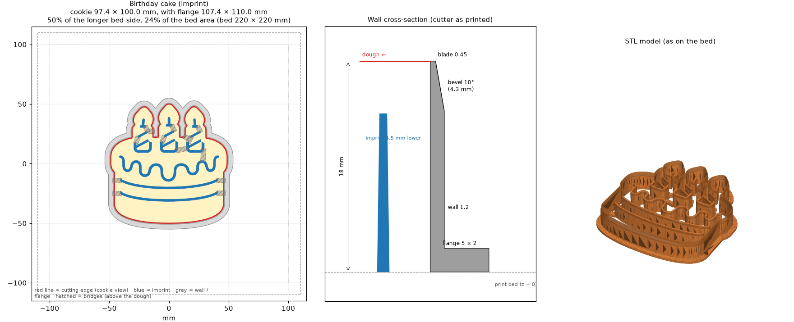 | [birthday cake with imprint](examples/birthday-cake-imprint/100mm/) |
| 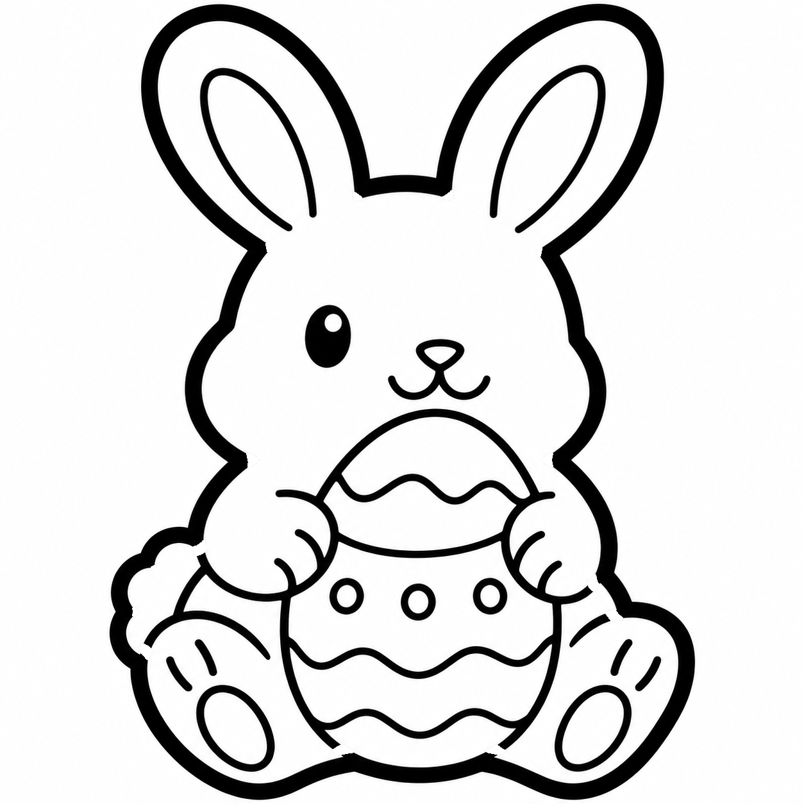 | 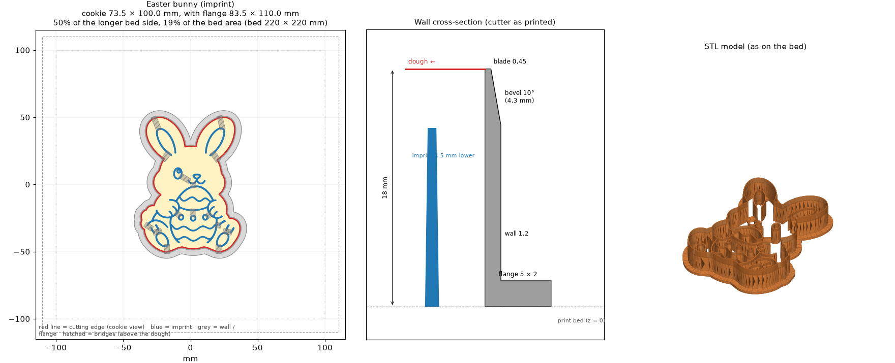 | [Easter bunny with imprint](examples/easter-bunny-imprint/100mm/) |

The imprint ridges press the pattern about 1.5 mm into the dough (set from the dough thickness,
`--dough 6` here), with the aim of keeping it visible after baking; the result depends on the
dough. In these two templates the inner lines touched the outline, so the skill first ran
`prepare`, which writes a version where they stop 1 mm short of it (otherwise every line would
be imprinted twice).

The reindeer shows a real warning: a 1.4 mm notch by the ear, where the template's ear line ends
open. Dough may stick there; `--smooth 0.8` would close it.

</details>

## Why not CAD or a similar tool?

It's faster. In CAD you trace the outline, offset the wall, model the bevel and the flange, and
check the fit yourself. Here you send a picture and answer a few questions, and the profile is
already tuned for cutting dough:

- The cutting edge is 0.45 mm, one nozzle line: thin enough to cut, wide enough that the
  slicer doesn't drop it.
- The 10° bevel is on the outside only, so the side of the cookie comes out straight and the
  dough is pushed toward the scraps.
- The 1.2 mm wall prints solid in three lines, and the 5 × 2 mm flange gives you something to
  press on and holds the print on the bed without a brim.
- Imprint ridges are set from your dough thickness to press about 1.5 mm in, a depth that tends
  to stay visible after baking.
- The model is mirrored, so text and left-facing animals come out the right way round.
- You're warned about parts too thin to survive and notches where dough will stick, and the
  cutter is checked against your printer's bed.
- Every STL is checked to be watertight and a single solid before you get it.

Need it smaller or smoother later? Ask, and it's rebuilt as a new version next to the old one.

## Quick start

You need **Git**, **Python 3.10+**, [**uv**](https://docs.astral.sh/uv/getting-started/installation/)
and **Claude Code**. Codex, Windows and other agents are under step 1.

No uv yet? `curl -LsSf https://astral.sh/uv/install.sh | sh` installs it on macOS and Linux.

### 1. Install the plugin

In your **terminal**:

```bash
claude plugin marketplace add DEVividious/cookie-forge
claude plugin install cookie-forge@cookie-forge
```

Already in a session? `/plugin install cookie-forge --marketplace DEVividious/cookie-forge` does
both (Claude Code 2.1.275 or later). The first cutter takes longer: the skill downloads its
geometry and image libraries (potentially hundreds of MB), so allow network access and a
writable uv cache. Later runs reuse them.

<details>
<summary><strong>Codex</strong></summary>

<br>

```bash
codex plugin marketplace add DEVividious/cookie-forge
codex plugin add cookie-forge@cookie-forge
```

In the next steps, start `codex` instead of `claude` and leave `/cookie-forge` out of the
prompt: Codex picks the skill, listed as `cookie-forge:cookie-forge`, from its description.

</details>

<details>
<summary><strong>Windows PowerShell</strong></summary>

<br>

Native Windows is **not yet verified end to end**. Treat these commands as a starting point and
read [Compatibility](#compatibility).

```powershell
# Install uv if needed, then reopen the terminal
winget install --id=astral-sh.uv -e

# Claude Code
claude plugin marketplace add DEVividious/cookie-forge
claude plugin install cookie-forge@cookie-forge

# Codex
codex plugin marketplace add DEVividious/cookie-forge
codex plugin add cookie-forge@cookie-forge
```

In step 2, write `curl.exe` instead of `curl`; the other commands work unchanged.

</details>

<details>
<summary><strong>Other agents or a manual install</strong></summary>

<br>

- **Other agents:** `npx skills add DEVividious/cookie-forge` uses the
  [skills.sh](https://skills.sh) installer, which copies the skill folder into your agent's
  skill directory. Add `-g` to install it for all projects.
- **Manual:** copy `plugins/cookie-forge/skills/cookie-forge/` from a clone into your agent's skill directory.
  `SKILL.md`, `scripts/` and `references/` must stay together.
- **Claude Code from a clone:** `claude --plugin-dir path/to/cookie-forge/plugins/cookie-forge`
  loads the plugin for one session. To load it in every session, copy or link that folder to
  `~/.claude/skills/cookie-forge`.

Details: [Claude Code plugins](https://code.claude.com/docs/en/plugins/install.md) and
[Codex skills](https://learn.chatgpt.com/docs/build-skills).

</details>

### 2. Add a template and open your agent

Work in a folder of your own. To start with the reindeer from this repository, run this in your
**terminal**:

```bash
mkdir my-cutters
cd my-cutters
curl -L -o reindeer.png https://raw.githubusercontent.com/DEVividious/cookie-forge/main/examples/reindeer/100mm/source.png
claude    # or open this folder in the Claude Code app or your IDE
```

Using your own picture? Put a PNG, JPG, WEBP or PDF there instead, or attach it in the chat.
A closed black outline on white works best. Only have an idea? See
[template prompts](plugins/cookie-forge/skills/cookie-forge/references/templates.md#prompts-for-image-models).

### 3. Paste this prompt into the agent chat

In the **Claude Code chat**, not the terminal:

```text
/cookie-forge Make a 100 mm cutter from reindeer.png for my Creality K1C. Outline only.
```

- Change the file, size or printer, or leave them out and the agent asks. Size is the
  **longest side of the cookie**, excluding the grip flange.
- Any language works: „Zrób foremkę z reindeer.png: 100 mm, Creality K1C, sam obrys.”
- Don't see `/cookie-forge`? Run `/reload-plugins` or restart Claude Code.

### 4. Approve the preview

The agent shows how it read the template and asks only for what is missing: printer, size, and
whether inner lines become an imprint. Then it shows the planned size, bed fit, checks and a 2D
preview. **It builds nothing until you approve.**

<details>
<summary>What the reindeer summary flags</summary>

<br>

An excerpt of the real dry-run summary for the reindeer in step 2:

| Check | Result | Recommended | Status |
|---|---|---|---|
| Thinnest cookie feature | ≈ 9.6 mm | ≥ 3.0 mm | OK |
| Narrowest notch | ≈ 1.4 mm | ≥ 2.0 mm | NARROW |
| Fits on the bed | 97.9 × 110.0 mm in 200 × 200 mm | 10.0 mm margin, 90° rotation allowed | OK |
| Height vs printer Z | 18.0 mm of 250 mm | — | OK |

> **Warnings**
> - the narrowest notch is about 1.4 mm - dough may stick in the cutter (recommended ≥ 2.0 mm)

The full summary also lists the construction, geometry processing and planned files. The 2D
preview shows the top view and wall cross-section, like the left two panels of
[this preview](examples/reindeer/100mm/preview.png). Reply with a change ("make it 80 mm",
"smooth that notch") and the agent repeats the dry run before asking again.

</details>

### 5. Print the STL

After you approve, the agent links `reindeer-100mm-v1.stl` (saved in
`cookie-forge-output/exports/<date>/`) and a rendered preview. Slice it flange down, without
supports. To iterate, just ask: *"Make the same cutter 80 mm"* or *"Simplify this outline and
show me the variants."*

## Try it without an agent

Run the geometry engine directly on the bundled reindeer. From a scratch folder, these commands
work as-is in Bash and PowerShell once Git and uv are installed:

```bash
git clone https://github.com/DEVividious/cookie-forge.git
cd cookie-forge
uv run plugins/cookie-forge/skills/cookie-forge/scripts/cookie_forge.py build examples/reindeer/100mm/source.png --size 100 --bed K1C --name reindeer --output-dir demo --dry-run --preview-2d
```

This prints the summary an agent would ask you to approve and writes the 2D preview to
`demo/projects/reindeer/previews/100mm-v1-dry-run.png`. The narrow-notch warning is expected.
Build the STL:

```bash
uv run plugins/cookie-forge/skills/cookie-forge/scripts/cookie_forge.py build examples/reindeer/100mm/source.png --size 100 --bed K1C --name reindeer --output-dir demo
```

Find it in `demo/exports/<build-date>/reindeer-100mm-v1.stl`, with a rendered preview at
`demo/projects/reindeer/previews/100mm-v1-model.png`. Repeat the build to see that identical
settings reuse the existing model.

<details>
<summary>Continue the demo: size table, outline simplification and a new version</summary>

<br>

See the size variants and the template reading:

```bash
uv run plugins/cookie-forge/skills/cookie-forge/scripts/cookie_forge.py analyze examples/reindeer/100mm/source.png --bed K1C --name reindeer --output-dir demo
```

Try a smoother outline without losing the original:

```bash
uv run plugins/cookie-forge/skills/cookie-forge/scripts/cookie_forge.py simplify --from demo/projects/reindeer/builds/100mm-v1
```

Open the comparison PNG printed by the command (for example,
`demo/projects/reindeer/previews/100mm-simplify-001.png`), compare the four variants, then try
your preferred level (shown here: `medium`):

```bash
uv run plugins/cookie-forge/skills/cookie-forge/scripts/cookie_forge.py build --from demo/projects/reindeer/builds/100mm-v1 --simplify-level medium --dry-run --preview-2d
```

Inspect the new dry-run preview, then build when ready:

```bash
uv run plugins/cookie-forge/skills/cookie-forge/scripts/cookie_forge.py build --from demo/projects/reindeer/builds/100mm-v1 --simplify-level medium
```

The result becomes `demo/exports/<build-date>/reindeer-100mm-v2.stl`; the original stays
available.

</details>

## Reference

<details>
<summary><strong>Command-line recipes</strong></summary>

<br>

These optional recipes assume you are in the repository and have supplied your own `cat.png`,
`sheet.pdf`, `star.png` and `donut.png`. For a runnable first example, use the
[demo](#try-it-without-an-agent). From another project, use the quoted absolute path to
`plugins/cookie-forge/skills/cookie-forge/scripts/cookie_forge.py` in your clone instead. Output is relative to the
current directory, not the script's location.

```bash
uv run plugins/cookie-forge/skills/cookie-forge/scripts/cookie_forge.py printers "k1c"                                  # printer bed
uv run plugins/cookie-forge/skills/cookie-forge/scripts/cookie_forge.py analyze cat.png --bed K1C --name cat           # reading + sizes
uv run plugins/cookie-forge/skills/cookie-forge/scripts/cookie_forge.py build cat.png --size 80 --bed K1C --name cat --dry-run --preview-2d
uv run plugins/cookie-forge/skills/cookie-forge/scripts/cookie_forge.py build cat.png --size 80 --bed K1C --name cat
uv run plugins/cookie-forge/skills/cookie-forge/scripts/cookie_forge.py build sheet.pdf --split --size original --bed "Prusa MK4"
uv run plugins/cookie-forge/skills/cookie-forge/scripts/cookie_forge.py build --mode merge "star.png@0,0,70" "donut.png@0,-40,36" --size 90
uv run plugins/cookie-forge/skills/cookie-forge/scripts/cookie_forge.py build cat.png --size 80 --bed K1C --lang pl     # Polish output
uv run plugins/cookie-forge/skills/cookie-forge/scripts/cookie_forge.py build cat.png --size 80 --imprint auto --dough 6 # with an imprint
uv run plugins/cookie-forge/skills/cookie-forge/scripts/cookie_forge.py simplify cat.png --size 80 --name cat         # outline simplification variants
uv run plugins/cookie-forge/skills/cookie-forge/scripts/cookie_forge.py build --from cookie-forge-output/projects/cat/builds/80mm-v1 --simplify-level medium  # change an existing project
uv run plugins/cookie-forge/skills/cookie-forge/scripts/cookie_forge.py prepare cat.png --name cat --size 80          # detach inner lines
uv run plugins/cookie-forge/skills/cookie-forge/scripts/cookie_forge.py paths --name cat                                # where files go
uv run plugins/cookie-forge/skills/cookie-forge/scripts/cookie_forge.py build --help
```

</details>

<details>
<summary><strong>Where your files go</strong></summary>

<br>

By default, everything lives in **`cookie-forge-output/` in your current project**.
`--output-dir DIR` replaces that workspace root (for example, `--output-dir demo` writes
`demo/projects/reindeer/…`, without an extra `cookie-forge-output` level).

```text
cookie-forge-output/
├── exports/                         open this folder for printing
│   └── 2026-10-25/
│       ├── reindeer-100mm-v1.stl
│       ├── reindeer-100mm-v2.stl
│       └── birthday-cake-80mm-v1.stl
└── projects/                        sources, previews and edit history
    └── reindeer/
        ├── templates/
        │   └── source-original.png
        ├── previews/
        │   ├── reading-001.png
        │   ├── 100mm-simplify-001.png
        │   ├── 100mm-simplify-002.png
        │   ├── 100mm-v1-dry-run.png
        │   └── 100mm-v1-model.png
        └── builds/
            ├── 100mm-v1/
            │   ├── source.png
            │   ├── project.json
            │   └── dry-run.json
            └── 100mm-v2/
                └── …
```

Open **`projects/<name>/previews/`** to compare outlines and inspect the model. Reading,
preparation and simplification previews get a new numbered filename on each run; earlier
comparisons stay. Model and dry-run previews are named after their build version. Repeating a
dry run for the same version refreshes that version's dry-run report and preview.

Print from **`exports/<build-date>/`**: all cutters built that day are together, named
`<name>-<size>mm-vN.stl`. These are the **only printable STL files**, not extra copies.
Each build's `project.json` points to its STL using a relative path. `builds/` keeps sources
and settings; it does not keep a second STL. Back up or move the **whole workspace**, including
previews and templates; `--from` infers the output root from the build's new location. The
agent also writes `notes.md` there. Size is rounded to whole millimeters in directory names;
exact dimensions are in the manifest.

A dry run writes no STL. Identical settings reuse an existing STL; changed settings create a
new version. Reusing an identical model keeps its original export date and creates no copy.
`--overwrite` explicitly rebuilds the same version into today's folder and removes its old
STL if the date changed; `--new-version` requests a separate version. If a previous STL was
deleted, its saved project still reserves that version, and a normal rebuild creates a new
version. Failed checks leave `cutter-rejected.stl`, never a file in `exports/`. `--json`
provides structured results with actual paths.

</details>

<details>
<summary><strong>Cutter standard</strong></summary>

<br>

Flange 5 × 2 mm on the bed, wall 1.2 mm, height 18 mm, cutting edge 0.45 mm with a 10° outer
bevel and a vertical inner side, outline only by default; with `--imprint auto` the template's
inner lines become an imprint (1.5 mm deep with `--dough`, otherwise 3.5 mm below the cutting
edge), loose parts joined with bridges, model mirrored (the cookie looks like the template).
Details and reasoning: [`geometry.md`](plugins/cookie-forge/skills/cookie-forge/references/geometry.md).

</details>

## Troubleshooting

| Symptom | What to do |
|---|---|
| Skill does not appear | Run `claude plugin list` or `codex plugin list` and check that `cookie-forge` is installed and enabled, then run `/reload-plugins` or restart the agent. After a manual install, `SKILL.md`, `scripts/` and `references/` must be together in the skill folder. Opening this repo does not install it; `claude --plugin-dir plugins/cookie-forge` loads it for one session. |
| `uv` is not found | Install uv and reopen the terminal or agent so it sees the updated PATH. |
| First run stalls or downloads fail | Allow package downloads through the host's permission flow and use a writable uv cache. Subsequent cached runs need no downloads. |
| Outline is wrong | Use a clean black outline on white; inspect the reading before building. See [template tips](plugins/cookie-forge/skills/cookie-forge/references/templates.md). |
| Preview is missing from the chat | Open the printed PNG path. A host without an image viewer cannot inspect it for you. |
| Model looks reversed | The STL is mirrored deliberately: the cutter is flipped when pressed into dough. |
| Need to edit an older cutter | Keep its workspace and use `--from`; an STL alone does not retain the source settings. |

## Compatibility

The workflow is designed for Claude Code, Codex and other agents that can load skills and run
local commands. The **host's tools and permissions**, not a particular model name, determine
whether it can execute the full workflow. An image viewer improves the experience; without one,
the agent asks you to inspect saved previews. No model API key is needed by the geometry script.

Native Windows support is **not yet verified end to end**. The Python code already uses path
joining and avoids common reserved filenames, but that is not a Windows test. In particular,
auto-generated build commands currently use POSIX quoting; ask the agent to adapt quoting to
PowerShell while preserving all arguments. Native Windows still needs automated tests for
installation, generation and workspaces with spaces or non-ASCII paths.

## Development

```bash
python3 -m unittest discover tests
```

The tests run the script with `uv run` on the simple templates in `tests/fixtures/` (drawn by
`make_fixtures.py`); a full run takes about 1–2 minutes, depending on the machine and cached
dependencies.

Run `uv run scripts/render_showcase.py` to regenerate the README animation, its still image and
the gallery from the example STL files. It renders the actual meshes without altering them.

To try your working copy, start Claude Code with `claude --plugin-dir plugins/cookie-forge`.
Before you push, run `claude plugin validate .` for the marketplace and
`claude plugin validate plugins/cookie-forge` for the plugin.

The script's libraries are pinned in `cookie_forge.py.lock` next to it, and the tests run with
`--locked`, so a stale lockfile fails them. After changing the dependencies in the script
header, run `uv lock --script plugins/cookie-forge/skills/cookie-forge/scripts/cookie_forge.py`;
add `--upgrade` to move the pins to newer versions.

For a release, change `VERSION` in `forge/__init__.py` and `version` in
`plugins/cookie-forge/.claude-plugin/plugin.json` together: installed plugins update only when
that version changes, and a test checks that both match.

<details>
<summary><strong>Repository layout</strong></summary>

<br>

- `.claude-plugin/marketplace.json`: makes this repository a marketplace that lists the plugin,
  so Claude Code and Codex can install it straight from GitHub.
- `plugins/cookie-forge/`: the plugin, the only folder an install copies. It holds
  `.claude-plugin/plugin.json`, a short `README.md`, a copy of `LICENSE` and the skill in
  `skills/cookie-forge/`.
- `plugins/cookie-forge/skills/cookie-forge/SKILL.md`: the model- and host-independent conversation flow.
- `plugins/cookie-forge/skills/cookie-forge/scripts/cookie_forge.py`: the command-line entry point (`--help` lists
  everything), with `cookie_forge.py.lock` pinning its libraries; the code is in the `forge/`
  package next to it, split by subdomain (dependencies only point downwards):

  ```
  forge/cli.py          argparse, error handling
  forge/commands/       one module per command: analyze, build, prepare, paths, printers
  forge/presentation/   dry-run summary, build report, PNG previews
  forge/project/        output layout and versions, manifest, settings from the command line
  forge/geometry/       2D outline, blade profile, cutter design, 3D solid and STL
  forge/template/       loading templates, contours -> shapes, collecting sources, prepare
  forge/printers.py, config.py, i18n.py (+ locale_pl.py), errors.py: shared basics
  ```

  User-facing text goes through `i18n.t()` / `Msg`; add the Polish version to `locale_pl.py`
  (the tests fail on a missing one). Library code raises `ForgeError` and never exits.
- `plugins/cookie-forge/skills/cookie-forge/references/`: `geometry.md`, `templates.md` and `printers.md`: profile
  standard, template tips and image-model prompts, printer bed table.
- `scripts/render_showcase.py`: renders the README animation and gallery from the example STLs.
- `examples/`: results of the whole skill, five cutters from three templates (see
  [Real results](#real-results)), plus the README showcase and gallery images.
- `tests/`: end-to-end tests of the summary, output layout, versions and manifests;
  `tests/fixtures/` holds their templates.
- `CHANGELOG.md`: changes of behaviour between versions.
- `LICENSE`: the MIT license.
- `.gitignore`: a whitelist; only the entries above are tracked, so cutters you make while
  developing (`cookie-forge-output/`, legacy `generated/` and `.work/`, templates, STL files)
  never end up in the repository. Add a new top-level file or directory to it on purpose.

</details>

## License

[MIT](LICENSE)
