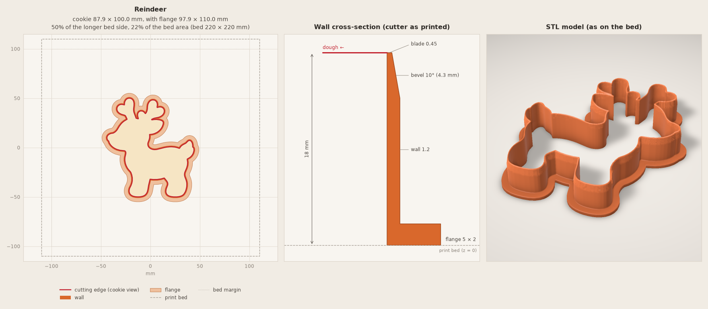

# Cookie Forge guide

The detail behind the [README](../README.md). To run the script yourself, see the
[command line](cli.md).

- [Walkthrough](#walkthrough)
- [Your printers](#your-printers)
- [Printing](#printing)
- [Where your files go](#where-your-files-go)
- [Cutter standard](#cutter-standard)
- [Troubleshooting](#troubleshooting)
- [Compatibility](#compatibility)

## Walkthrough

Install the plugin first: see the [README](../README.md#make-your-first-cutter).

### 1. Add a template and open your agent

Work in a folder of your own. To start with the reindeer from this repository, run this in your
terminal:

```bash
mkdir my-cutters
cd my-cutters
curl -L -o reindeer.png https://raw.githubusercontent.com/DEVividious/cookie-forge/main/examples/reindeer/100mm/source.png
claude    # or open this folder in the Claude Code app or your IDE
```

In Windows PowerShell, write `curl.exe` instead of `curl`. With Codex, start `codex` instead of
`claude`.

Using your own picture? Put a PNG, JPG, WEBP or PDF there instead, or attach it in the chat.
A closed black outline on white works best. Only have an idea? See the
[template prompts](../plugins/cookie-forge/skills/cookie-forge/references/templates.md#prompts-for-image-models).

### 2. Paste the prompt into the agent chat

In the chat, not the terminal:

```text
/cookie-forge Make a 100 mm cutter from reindeer.png for my Creality K1C. Outline only.
```

- Change the file, size or printer, or leave them out and the agent asks. Size is the
  **longest side of the cookie**, excluding the grip flange.
- Any language works: „Zrób foremkę z reindeer.png: 100 mm, Creality K1C, sam obrys.”
- In Codex, leave `/cookie-forge` out: it picks the skill, listed as `cookie-forge:cookie-forge`,
  from its description.
- Don't see `/cookie-forge`? Run `/reload-plugins` or restart Claude Code.

### 3. Approve the preview

The agent shows how it read the template and asks only for what is missing: printer, size, and
whether inner lines become an imprint. Then it shows a short card with the size, bed fit and any
warnings, next to a 2D preview. **It builds nothing until you approve.**

The real card for the reindeer:

> - Cookie 87.9 × 100.0 mm, with the flange 97.9 × 110.0 mm
> - Printer: Creality K1C (bed 220 × 220 × 250 mm), 50% of the longer bed side
> - Outline only, no imprint
> - 18.0 mm tall, cutting edge 0.45 mm with a 10° bevel
> - Warning: the narrowest notch is about 1.4 mm - dough may stick in the cutter (recommended ≥ 2.0 mm)

The preview shows the top view and wall cross-section, like the left two panels here:



Ask for details and the agent shows the full summary with every measured check. Reply with a
change ("make it 80 mm", "smooth that notch") and the agent repeats the dry run before asking
again.

That warning is real: the reindeer has a 1.4 mm notch by the ear, where the template's ear line
ends open. Dough may stick there; smoothing (`--smooth 0.8`) closes it.

### 4. Print the STL

After you approve, the agent links `reindeer-100mm-v1.stl` (saved in
`cookie-forge-output/exports/<date>/`) and a rendered preview. To iterate, just ask: *"Make the
same cutter 80 mm"* or *"Simplify this outline and show me the variants."* Each change is built
as a new version next to the old one.

### With an imprint

Ask for an imprint and the template's inner lines become lower ridges. They press the pattern
about 1.5 mm into the dough (set from the dough thickness you give, `--dough 6` in the
[examples](../examples/)), with the aim of keeping it visible after baking; the result depends
on the dough.

If the inner lines touch the outline, as in the bunny and the cake, the skill first runs
`prepare`, which writes a version of the template where they stop 1 mm short of it. Otherwise
every line would be imprinted twice.

## Your printers

The skill can remember the printers you own, so it offers them as a choice instead of asking
every time. Tell the agent once, for example *"Add my default printers: Creality K1C and Bambu
Lab P2S with AMS 2 Pro"*, and it saves them. With one saved printer it just confirms it; with
several it asks which one the cutter is for.

The list is a plain markdown file, `~/.config/cookie-forge/printers.md` (under
`$XDG_CONFIG_HOME` if set, or wherever `COOKIE_FORGE_PRINTERS` points). It lives outside the
plugin folder because a plugin update replaces that folder. Rows use the format of the
[bed table](../plugins/cookie-forge/skills/cookie-forge/references/printers.md); leave the size
empty for a printer from that table and give it for any other:

```markdown
| Maker | Model | X × Y × Z | Notes |
|---|---|---|---|
| Creality | K1C | 220 × 220 × 250 | |
| Bambu Lab | P2S | | AMS 2 Pro |
| Homebrew | CoreXY 300 | 300 × 300 × 320 | my own build |
```

From the [command line](cli.md): `printers --mine` lists them,
`printers --add "Bambu Lab P2S" --note "AMS 2 Pro"` adds one (`--bed 350x350x340` for a printer
not in the table) and `printers --remove "K1C"` removes it. `build --bed "P2S"` finds your saved
printers first.

## Printing

Print the STL as it is: flange on the bed, cutting edge up, no supports, no brim.

- 0.2 mm layers and 3 perimeters, so the 1.2 mm wall comes out solid.
- PLA or PETG. No carbon fibre or glitter filaments.
- Seam random or rear, not "nearest", so there is no bump on the cutting edge.
- Wash by hand in lukewarm water, not in the dishwasher: PLA softens at 60 °C.

The full settings table is in
[`geometry.md`](../plugins/cookie-forge/skills/cookie-forge/references/geometry.md#printing).

## Where your files go

By default, everything lives in **`cookie-forge-output/` in your current project**.
`--output-dir DIR` replaces that workspace root (for example, `--output-dir demo` writes
`demo/projects/reindeer/…`, without an extra `cookie-forge-output` level).

```text
cookie-forge-output/
├── exports/                         open this folder for printing
│   └── 2026-10-25/
│       ├── reindeer-100mm-v1.stl
│       ├── reindeer-100mm-v2.stl
│       └── birthday-cake-80mm-v1.stl
└── projects/                        sources, previews and edit history
    └── reindeer/
        ├── templates/
        │   └── source-original.png
        ├── previews/
        │   ├── reading-001.png
        │   ├── 100mm-simplify-001.png
        │   ├── 100mm-simplify-002.png
        │   ├── 100mm-v1-dry-run.png
        │   └── 100mm-v1-model.png
        └── builds/
            ├── 100mm-v1/
            │   ├── source.png
            │   ├── project.json
            │   └── dry-run.json
            └── 100mm-v2/
                └── …
```

**Print from `exports/<build-date>/`.** All cutters built that day are together, named
`<name>-<size>mm-vN.stl`. These are the only printable STL files, not extra copies: each build's
`project.json` points to its STL with a relative path, and `builds/` keeps sources and settings
but no second STL. Size is rounded to whole millimeters in names; exact dimensions are in the
manifest.

**Compare in `projects/<name>/previews/`.** Reading, preparation and simplification previews
get a new numbered filename on each run, so earlier comparisons stay. Model and dry-run previews
are named after their build version; repeating a dry run for the same version refreshes them.

**Back up or move the whole workspace**, including previews and templates. `--from` infers the
output root from the build's new location.

Versions:

- A dry run writes no STL.
- Identical settings reuse the existing STL, keep its export date and create no copy. Changed
  settings create a new version.
- `--overwrite` rebuilds the same version into today's folder and removes its old STL if the
  date changed. `--new-version` requests a separate version.
- If an STL was deleted, its saved project still reserves that version, so a normal rebuild
  creates a new one.
- Failed checks leave `cutter-rejected.stl`, never a file in `exports/`.
- `--json` returns structured results with the actual paths.

## Cutter standard

Flange 5 × 2 mm on the bed, wall 1.2 mm, height 18 mm, cutting edge 0.45 mm with a 10° outer
bevel and a vertical inner side. Outline only by default.

- The cutting edge is 0.45 mm, one nozzle line: thin enough to cut, wide enough that the
  slicer doesn't drop it.
- The bevel is on the outside only, so the side of the cookie comes out straight and the dough
  is pushed toward the scraps.
- The wall prints solid in three lines, and the flange gives you something to press on and
  holds the print on the bed without a brim.
- With `--imprint auto` the template's inner lines become an imprint: 1.5 mm deep with
  `--dough`, otherwise 3.5 mm below the cutting edge. Loose parts are joined with bridges.
- The model is mirrored, so the cookie looks like the template: text and left-facing animals
  come out the right way round.
- You're warned about parts too thin to survive and notches where dough will stick, and the
  cutter is checked against your printer's bed.
- Every STL is checked to be watertight and a single solid before you get it.

Details and reasoning:
[`geometry.md`](../plugins/cookie-forge/skills/cookie-forge/references/geometry.md).

## Troubleshooting

| Symptom | What to do |
|---|---|
| Skill does not appear | Run `claude plugin list` or `codex plugin list` and check that `cookie-forge` is installed and enabled, then run `/reload-plugins` or restart the agent. After a manual install, `SKILL.md`, `scripts/` and `references/` must be together in the skill folder. Opening this repo does not install it; `claude --plugin-dir plugins/cookie-forge` loads it for one session. |
| `uv` is not found | [Install uv](https://docs.astral.sh/uv/getting-started/installation/) and reopen the terminal or agent so it sees the updated PATH. |
| First run stalls or downloads fail | The first run downloads the geometry and image libraries (potentially hundreds of MB). Allow package downloads through the host's permission flow and use a writable uv cache. Later runs reuse the cache and need no downloads. |
| Outline is wrong | Use a clean black outline on white; inspect the reading before building. See [template tips](../plugins/cookie-forge/skills/cookie-forge/references/templates.md). |
| Preview is missing from the chat | Open the printed PNG path. A host without an image viewer cannot inspect it for you. |
| Model looks reversed | The STL is mirrored deliberately: the cutter is flipped when pressed into dough. |
| Need to edit an older cutter | Keep its workspace and use `--from`; an STL alone does not retain the source settings. |

## Compatibility

The workflow is designed for Claude Code, Codex and other agents that can load skills and run
local commands. The **host's tools and permissions**, not a particular model name, determine
whether it can execute the full workflow. An image viewer improves the experience; without one,
the agent asks you to inspect saved previews. The geometry script needs no model API key.

Native Windows support is **not yet verified end to end**. The Python code already uses path
joining and avoids common reserved filenames, but that is not a Windows test. In particular,
auto-generated build commands currently use POSIX quoting; ask the agent to adapt quoting to
PowerShell while preserving all arguments. Native Windows still needs automated tests for
installation, generation and workspaces with spaces or non-ASCII paths.
